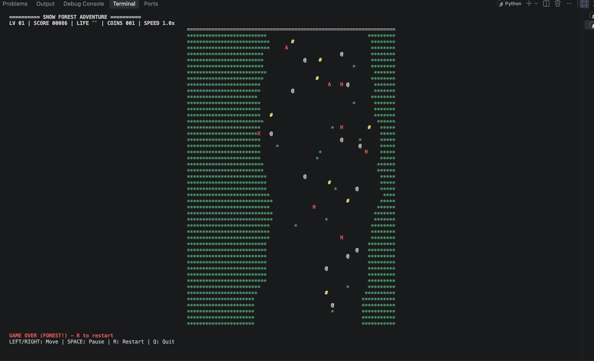

# SNOW FOREST ADVENTURE

## 1. ゲーム概要

「ASCII SKI GAME」をベースに改良したスキーゲームです。
プレイヤーを操作し、森の中で木や石、敵プレイヤーを避けながら、コインや回復アイテムを集めて高得点を目指します。
レベルが上がるにつれてゲームの速度が速くなります。

## 2. 動作環境

- Python 3
- macOS / Linux
- Windows（windows-curses が必要）
- Visual Studio Code
- curses ライブラリ
- ターミナルサイズ：64列 × 21行以上

## 3. インストール方法

Python 3をインストールしてください。

macOSでは、基本的に追加ライブラリのインストールは不要です。

Windowsの場合は、以下のコマンドを実行してください。

```bash
pip install windows-curses
```

## 4. 起動方法

ターミナルで以下のコマンドを実行してください。

```bash
python3 w11_ski_demo.py
```

Windowsの場合：

```bash
python w11_ski_demo.py
```

## 5. 操作方法

| キー | 操作 |
|---|---|
| SPACE | ゲーム開始・一時停止・再開 |
| ← | 左方向へ移動 |
| → | 右方向へ移動 |
| R | ゲームオーバー後の再スタート |
| Q | ゲーム終了 |

## 6. ゲーム内の記号

| 記号 | 内容 |
|---|---|
| O | プレイヤー |
| * | 木・森 |
| # | 石 |
| H | ライフ回復アイテム |
| @ | コイン |
| A | 敵プレイヤー |
| X | ゲームオーバー |
| ❤️ | 残りの予備ライフ |
| 🖤 | 予備ライフなし |

## 7. 追加・改良した機能

### 改良機能01：石の追加

木だけでなく、石を障害物として追加しました。
石に衝突するとライフが減少します。

### 改良機能02：ライフ機能・回復アイテム

予備ライフ機能を追加しました。
障害物に衝突しても、予備ライフがあればゲームを続けることができます。

回復アイテム（H）を取得するとライフが1つ増加します。
予備ライフの最大数は3です。

### 改良機能03：コイン収集機能

コース内にコイン（@）がランダムに出現します。
コインを取得するとスコアが10点増加します。
取得したコインの数も画面に表示されます。

### 改良機能04：スピードアップ機能

100行進むごとにレベルが1つ上がります。
レベルアップするたびに速度倍率が0.5ずつ増加します。
ゲームが進むにつれて難易度が高くなります。

### 改良機能05：敵プレイヤーの追加

敵プレイヤー（A）を追加しました。
敵プレイヤーはランダムに出現し、衝突するとライフが減少します。

### 改良機能06：カラー表示機能

cursesライブラリを使用して、ゲーム内の記号を色分けしました。

- 木・森：緑色
- 石：黄色
- コイン：白色
- プレイヤー：白色
- 敵プレイヤー：赤色
- 回復アイテム：赤色
- ゲームオーバー：赤色

色分けすることで、障害物やアイテムを見分けやすくしました。

## 8. ゲーム実行画面



## 9. 実装状況

- [x] 石の追加
- [x] ライフ機能・回復アイテム
- [x] コイン収集機能
- [x] スピードアップ機能
- [x] 敵プレイヤーの追加
- [x] カラー表示機能

## 10. 既知の問題・今後の課題

- 敵プレイヤーはコースと一緒に移動し、独立したAIによる移動は未実装です。
- ターミナルによってハートの表示が異なる場合があります。
- ゲーム中にターミナルのサイズを変更すると、ゲームが初期化されます。
- Windowsでの動作確認はまだ行っていません。
- ゲーム速度の上限は設定していません。

## 11. クレジット

- ベースゲーム：授業配布の ASCII SKI GAME
- 使用言語：Python
- 使用ライブラリ：curses、random、time、collections
- 制作：プログラミング演習 最終制作課題

